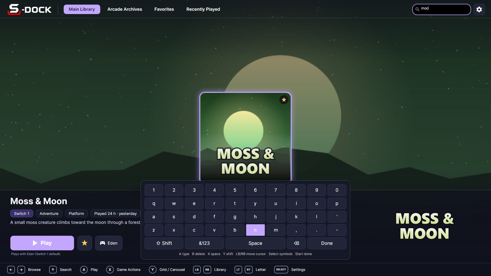
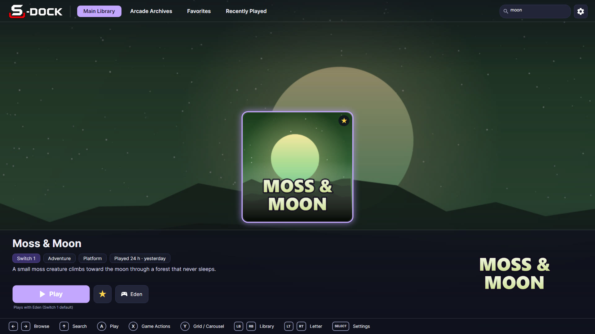
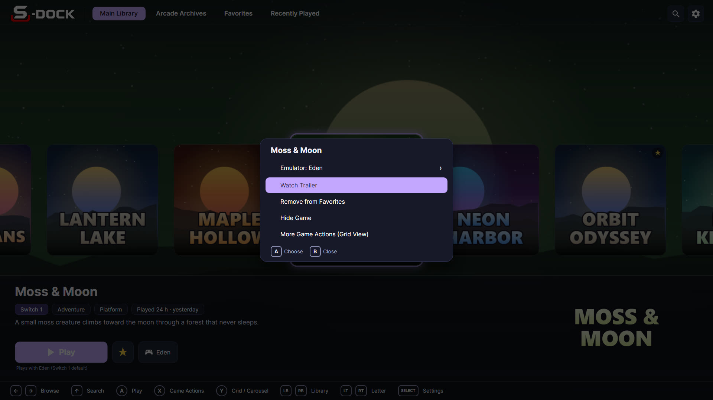

# S-Dock 1.2.0

**S-Dock** is a controller-friendly Windows frontend for switch game libraries. Point it at your own
game folders and your own emulator, and browse everything in a full-screen carousel or a grid, with
covers, backgrounds, logos and descriptions filled in for you.

> S-Dock does not include or download games, firmware, keys or system files, and it never changes
> your game files. You bring your own games and emulator.

## What's new

- **Trailers inside S-Dock.** **Game Actions → Watch Trailer** plays the game's trailer full screen,
  right in S-Dock. With a controller: A pauses, Left and Right skip 10 seconds, Up and Down change
  the volume, and B closes it. Trailers are found through IGDB.
- **On-screen keyboard.** Search, Rename and other text boxes bring up a keyboard you can type on
  with a controller: A types, B deletes, X adds a space, Y is Shift, and Start is Done. With a real
  keyboard it stays out of the way.
- **Search in the carousel.** Press Up in the carousel to search, then pick from the results.
  LT and RT still jump by letter.





*Screenshots use a demo library of fictional games.*
## Download

**`S-Dock-1.2.0-win-x64.zip`**: unzip it and you have an **S-Dock** folder with everything in it. There's nothing to
install.

The other files (`.nupkg`, `releases.win.json`, `assets.win.json`, `RELEASES`) are what S-Dock's
automatic updates download; you don't need them yourself. (When publishing: attach every file in
`releases\`, and publish it as a full release, not a pre-release, or automatic updates won't offer it.)

**Requirements:** 64-bit Windows 10 or 11. Nothing else needs installing.

**Updating:** from 1.0.0 on, S-Dock offers this update itself when it starts (or use **Settings →
About → Check for updates**). From a 0.1.0 beta: unzip this one, then copy the `data` and
`emulators` folders from your old S-Dock folder into the new one.

## Getting started

1. Unzip the download wherever you like: Documents, another drive or a USB stick (not
   `C:\Program Files`, where Windows doesn't let programs save).
2. Run `S-Dock.exe` in the S-Dock folder. S-Dock isn't code-signed yet, so Windows SmartScreen may
   say "Windows protected your PC": choose **More info → Run anyway**.
3. Open **Settings** (the gear, or Select on a controller):
   - **Emulators → Emulator Profiles…** to add your emulator (put emulator builds in the S-Dock
     folder's `emulators` folder and they're found automatically);
   - **Library → Add Folder…** to add your games;
   - let S-Dock download **TitleDB** when it asks, to fill in names, descriptions and pictures.

Everything S-Dock saves (library, artwork, TitleDB, settings) stays in the `data` folder inside the
S-Dock folder, and nowhere else on your PC. To move S-Dock, move the folder; to remove it, delete
the folder.

## Known limitations

- Windows' file and folder pickers (Add Folder, choosing an image) still need a keyboard and mouse.
- The app isn't code-signed (see the SmartScreen note above).

## Feedback

Please report problems and ideas in [Issues](https://github.com/artlevandoski/s-dock/issues). It
helps to include the version (Settings → About) and, after an error, the
file `data\logs\errors.log`.

<!-- build-info: filled in by build\package.ps1 -->
## Checksum (SHA-256)

```
21897c439c11ab3305367d299c50ff9f1f5f57fb9849623f71d35ea6b7ade39e  S-Dock-1.2.0-win-x64.zip
```

Built from commit `74f848e`.
<!-- /build-info -->
